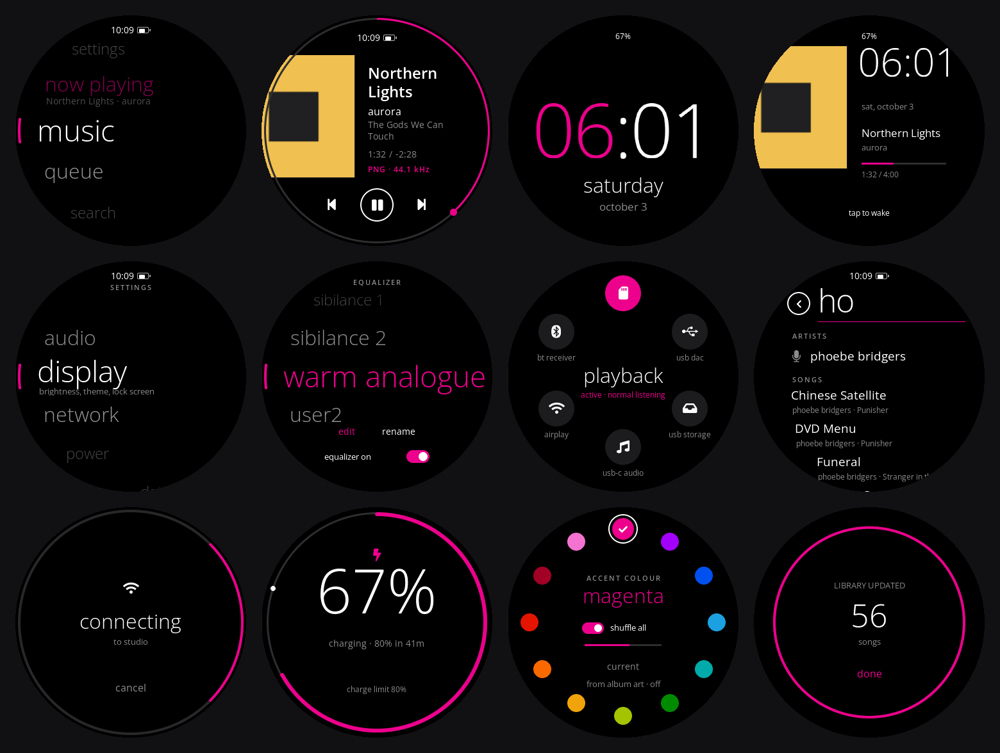
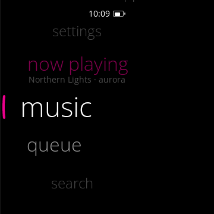
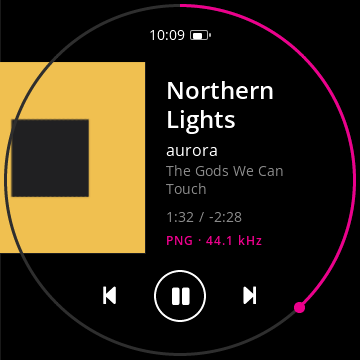
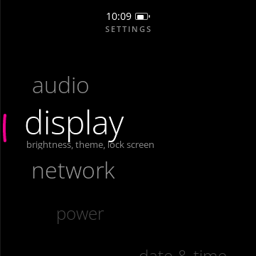
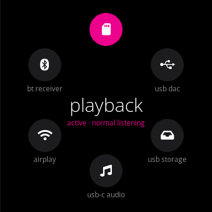
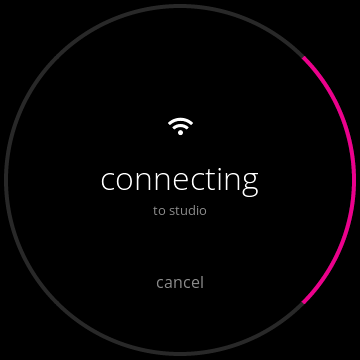
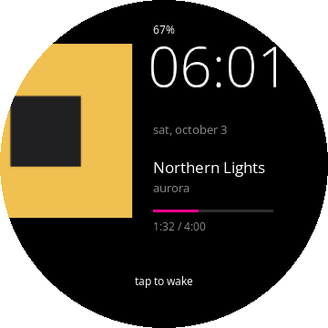

# Zune — a Metro-style theme for diskOS Disco!

Zune is a theme for the [diskOS Disco!](../README.md) touch UI on the FiiO Snowsky Disc, inspired by the
Zune HD's Metro look: big lowercase type, a single accent colour and a round, looping dial for the home
menu and every list. It is a theme inside the stock `mq_ui`, so every diskOS Disco! feature is still
there. You can switch between Zune and the other themes at any time.

<p align="center"></p>

> [!NOTE]
> This is an unofficial fan theme. It is not affiliated with Microsoft, FiiO or Snowsky. "Zune" is used only
> to describe the visual style. It uses no Microsoft assets: the type is Open Sans (SIL OFL 1.1) and every
> icon and layout is drawn from scratch.

## What you get

| | |
|---|---|
|  | **Home**: one big lowercase list (now playing, music, queue, search, equalizer, modes, bluetooth, wi-fi, weather, apps, settings). It loops endlessly and scrolls freely. |
|  | **Now Playing**: the cover in the background with the seek ring on the rim, plus large title/artist text and the format line. Optionally takes its accent from the album art. |
|  | **Settings and lists**: one looping dial that scrolls with momentum. The rows follow the round screen. |
|  | **Working mode**: six circles, including **usb-c audio** for USB-C headphones or a DAC, next to BT receiver, USB DAC, AirPlay and USB storage. |
|  | **Wi-Fi and Bluetooth**: scanning spins an accent arc on the rim. Connecting and failed are full-screen takeovers. |
|  | **Lock screen**: album art or clock only. Charging, library scan, search, EQ and accent picker are themed as well. |

Behaviour worth knowing:

- **Settings > Output** (Zune only) opens an output picker. Working mode > **usb-c audio** switches playback to the
  USB-C port. The Disc cannot see a USB device until it has switched, so it switches first and then waits up to
  8 s for the DAC.
- If the Disc is switched off while on USB-C audio, it starts on the internal output next time. This means it
  will not skip through songs with nothing plugged in.
- At 2% battery a shutdown countdown appears after two readings in a row. Plugging in cancels it.
- Locking blanks the screen fully: a black cover is drawn and the backlight is switched off.

## Install

Zune ships as part of the UI binary (`mq_ui`). You install it the same way as any diskOS Disco! UI update.

**You need a Disc that already runs diskOS Disco! with your own update key.** If you are starting from stock
firmware, follow the main [Install](../README.md#install) guide first. That guide flashes diskOS with your
public key (`ui/tools/owner-keys/diskos-keys.sh`).

Every Disc only accepts updates signed with its owner's key, so nobody can hand you a ready-signed package.
You either build `mq_ui` yourself or take one from this repo's Releases, and then sign it yourself.

### 1. Get `mq_ui`

**Option A: download** the `mq_ui` asset from this fork's Releases page.

**Option B: build** with the pinned Docker builder (macOS, Linux or WSL):

```sh
git clone <this repo> diskos-disco && cd diskos-disco/ui
docker build -t diskos-ui-builder .            # once
docker run --rm -u "$(id -u):$(id -g)" -v "$PWD:/src" diskos-ui-builder
cd ..
```

The binary lands in `ui/mq_ui`. A manual cross-toolchain build is described in [DEV_WORKFLOW.md](DEV_WORKFLOW.md).

### 2. Sign it with your key

Run this from the repository root, with your `diskos-keys/` folder there or passed as the third argument:

```sh
sh ui/tools/owner-keys/diskos-sign.sh ui/mq_ui 2.6.1-zune1
```

The label (`2.6.1-zune1`) is free text. The Disc refuses a package that is older than the last one it
accepted, so if you re-sign the same build later, sign it again rather than reusing an old folder.

### 3. Copy to the SD card and update

```sh
cp -R diskos-update /Volumes/<your card>/      # macOS; any file manager works
```

Eject the card and put it in the Disc, then accept the update. diskOS keeps the previous UI as a trial
rollback: play music for about 30 s or tap **Keep** to confirm the new one. More detail is in
[UPDATING.md](UPDATING.md).

On macOS, if `cp` says *Permission denied* on the card, give Terminal access to Removable Volumes
(System Settings > Privacy & Security > Files and Folders), or drag the folder across in Finder.

### 4. Turn it on

**Settings > Display > Theme**, then choose **Zune**. The UI restarts into Zune. Under Display you can change the accent
colour, switch the lock screen between album art and clock only, and turn **from album art** on or off.

To go back, pick any other theme in the same menu. Nothing else changes.

## Previewing on a computer

The host renderer draws any screen to an image without a Disc:

```sh
make -C ui clean && make -C ui CROSS= host-render
ZNP_PATH=some-cover.png ui/tests/host_build/host-render 13 0 preview-home 0 out.ppm
```

Preset `13` is Zune. Pages include `preview-home`, `preview-scr2` (now playing) and the other `preview-*`
names in `ui/tests/host_render.c`. Run `make -C ui clean` again before building for the Disc.

## Changing the theme

| File | What it holds |
|---|---|
| `ui/zune_home.c` | Home list and its looping layout |
| `ui/zune_dial.c/.h` | Round looping dial for lists and settings, takeovers, toasts, rim spinner, scan screen |
| `ui/zune_thumbs.c/.h`, `ui/zune_saver.c` | Album thumbnails and the lock/idle screen |
| `ui/theme_defs.c`, `ui/theme_kits.c` | Font table and widget style for the Zune preset |
| `ui/modes.c` | Working modes, output picker and USB-C audio route |
| `ui/font_zune_*.c` | Open Sans cut to fixed sizes, made by `ui/tools/gen_zune_fonts.py` |

Elsewhere, Zune branches are marked with `th_zune()`. To regenerate the fonts (for new sizes or glyphs),
use the Open Sans variable font and `lv_font_conv` 1.5.3:

```sh
python3 ui/tools/gen_zune_fonts.py --src path/to/OpenSans-VF.ttf
```

Before you open a pull request, run `make -C ui check-theme` and the tests in [DEV_WORKFLOW.md](DEV_WORKFLOW.md).

## Known gaps

- The power-key menu is not themed, because the player owns the long press.
- Some deep screens (file browser, books, a few app interiors) use Zune fonts but keep the stock layout.
- There is no install-progress screen. diskOS shows only the update dialog.
- Not tested much yet: AirPlay, the EQ editor, the USB storage screen and sleep-timer edge cases. Reports are welcome.

## Licence and credits

- The UI code is GPL-3.0-or-later, the same as diskOS Disco! (see [ui/COPYING](../ui/COPYING)).
- The Open Sans fonts are under the SIL Open Font License 1.1 (see [licenses/OpenSans-OFL.txt](../licenses/OpenSans-OFL.txt)).
- Built on [diskOS Disco!](https://github.com/zmd22/diskos-disco) by zmd22 and [diskOS](https://github.com/b0hemia/diskos) by b0hemia.
